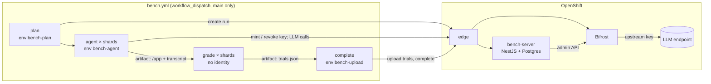

# Skill benchmark

Does a skill make coding agents better at what it teaches, and at what cost? The benchmark answers
that per skill and per model by running the same tasks **without** and **with** the skill installed,
grading every result deterministically, and comparing the two arms trial for trial.

It is run by hand (`workflow_dispatch` on `bench.yml`), never on pull requests: a run spends real
LLM budget.

## What a run measures

- **Arms.** Each task runs `without` any skill and `with` the evaluated skill, installed where the
  harness looks for skills (Harbor `--skill`). The prompt is the same natural request in both arms
  and never names the practice. A `bundle` arm (every skill installed) comes once there are two
  skills.
- **Cells.** Each harness × model pair is evaluated on its own: a frontier model may already follow
  the practices, and gain speed rather than score; a smaller one may gain score.
- **Tasks and checks.** `bench/evals/<skill>.yaml` lists the tasks a skill is measured on, the
  **target** checks it claims to fix and the **control** checks it must not break. The file lives
  outside `skills/`, so `npx skills` never ships it.
- **Per trial.** `works` (rebuilt from scratch, started, answers an HTTP probe), each check (`pass`,
  `fail`, `na`, `error`, with evidence), whether the agent loaded the skill, tokens, turns, tool
  calls, agent time, and cost.

## How results are judged

- **Paired Δ.** For each task, the mean target score with the skill minus without it, averaged over
  tasks.
- **Confidence.** A 95% interval from a two-stage cluster bootstrap (resample tasks, then trials
  within each arm; 10 000 resamples, fixed seed): trials of one task are correlated, so tasks are
  the unit.
- **Verdict.** **Helps** when the interval is above zero, **Hurts** when below, **No effect**
  otherwise. A **regression** is flagged when the control score or `works` gets significantly worse.
- **Trigger rate.** The share of `with` trials where the agent read the skill's `SKILL.md` or called
  its skill tool. A skill that never loads can't help, whatever it says: that points at its
  `description`.

## The report

Each completed run has a page, `/runs/<run id>`, built from the published data:

1. Headline tiles: verdict, Δ target checks, Δ tokens, skill loaded, run cost.
2. **Better, cheaper, or both?** One arrow per model from *without* to *with*: up is better, left
   is cheaper.
3. **Real or noise?** Δ with its interval around zero, the verdict, and control checks.
4. **What did it fix?** Pass rate per check, without and with, per model.
5. **What does it cost the agent?** Tokens, turns and time, one panel per measure.
6. **Was the skill loaded?** Loaded and succeeded, loaded and failed, not loaded.
7. Drill-down: Δ per task and check.

Every chart has a table view. `pnpm --filter @podman-desktop/agent-skills-bench-report build`, then
`pnpm --filter @podman-desktop/agent-skills-bench-server mockup`, renders the page on invented data.

## Raw data

Public and read-only, served from the server's database:

| Path | Content |
|---|---|
| `GET /api/v1/runs` | Every run: skill, version, cells, cost, verdicts |
| `GET /api/v1/runs/:id` | One run: inputs, shards, gateway billing per shard |
| `GET /api/v1/runs/:id/trials` | One trial per line (NDJSON), checks with evidence, link to the transcript artifact |
| `GET /api/v1/runs/:id/results` | The aggregates the report shows |
| `GET /api/v1/schema/v1/<name>.json` | JSON Schema of each document (`run`, `run-summary`, `trial`, `published-trial`, `results`, `eval`) |
| `GET /api/v1/openapi.json` | The server's OpenAPI document, workflow endpoints included |

Transcripts and the agents' final files stay in the workflow run's artifacts (30 days).

## Architecture



| Package | Role |
|---|---|
| `bench/server` | NestJS on `@nestjs/platform-node`, Drizzle + Postgres: runs, keys, trials, results, report, API. Its zod schemas (`src/contracts`) are the source of truth: requests are validated with them, and its OpenAPI document (`@nestjs/swagger`, in `bench/server/openapi/`) is generated from them, every schema a named component |
| `bench/server-client` | Generated from that document by `@hey-api/openapi-ts`: the client, the types (`Trial`, `Results`…) and their zod validators. The runner and the report depend on it, never on the server's code |
| `bench/report` | Vega-Lite charts and the report page |
| `bench/runner` | The workflow's CLI: `plan`, `agent` (Harbor), `grade`, `complete`, `oracles` |
| `bench/tasks` | Task apps, specs and oracles |
| `bench/sandbox` | The image agents work in (Fedora, nested Podman) |
| `bench/deploy` | Bifrost's configuration and the OpenShift manifests |

## Trust

- **The server holds every credential and has none for GitHub.** It never triggers workflows or
  writes to the repository; jobs call it with a GitHub Actions OIDC token.
- **Tokens are checked against the bench workflow on main:** immutable repository and owner ids,
  `job_workflow_ref`, `ref` (protected), `event_name: workflow_dispatch`, a GitHub-hosted runner,
  an allowed `actor_id`. Every call after the run's creation must come from the same `run_id`.
- **Each job has its own environment, and each environment its own endpoints.** The agent runs in a
  privileged nested container: assume it is root on its runner and can mint OIDC tokens. Those carry
  `environment: bench-agent`, which can mint or revoke the run's keys and nothing else. Grading runs
  on another runner without any identity; uploads come from a job that only parses JSON.
- **Keys** are Bifrost virtual keys, one per shard and attempt: allowed only the shard's model,
  capped at the shard's share of the run's cap (≤ `MAX_RUN_USD`) and a daily cap, expiring after
  trials × agent timeout + 30 minutes. One run at a time. Usage is read after Bifrost's usage lag,
  then the key is deleted. The gateway's usage is the cost of record; agent-reported tokens are
  cross-checked against it.
- **Exposure.** The edge forwards exact inference paths to Bifrost and the server's public routes;
  Bifrost's admin API is cluster-internal. NetworkPolicies are default-deny.
- **Untrusted output.** Evidence strings are bounded and rendered as text; the report runs under a
  strict CSP; the job summary carries server-computed numbers and validated identifiers only.
- **Accepted residual risk:** from inside its job, an agent could mint keys for other shards of the
  same run (bounded by the run's cap, visible as a key without trials), or forge its own transcript
  and token counts (agent-reported, cross-checked).

## Generated files

CI fails when one of them is out of date; regenerate with:

```sh
pnpm --filter @podman-desktop/agent-skills-bench-server gen         # OpenAPI document
pnpm --filter @podman-desktop/agent-skills-bench-server-client gen  # client, from the document
```

## Tasks and oracles

A task is `bench/tasks/<id>/`: `instruction.md`, `app/` (what the agent starts from, with a planted
fake secret where relevant), `task.yaml` (gate, probe, platform constraints) and `oracles/`. Each
oracle is a known solution overlaid on the app with its expected grade (`expect.yaml`): a `best`
one, valid alternatives and a `naive` one. `bench-ci.yml` grades every oracle on each pull request,
so a grader change that would misjudge a known answer fails before any agent is graded by it.

```sh
node --conditions=@podman-desktop/agent-skills-source bench/runner/src/cli.ts oracles   # needs Podman
```

## Running a benchmark

1. Publish the sandbox image (`bench-sandbox.yml`, `:main`). Its digest lives in
   `bench/sandbox/task.Containerfile`, which Dependabot keeps current; set it by hand the first time.
2. Dispatch `bench.yml` from main with the skill, the cells
   (`[{"harness":"opencode","model":"gpt-oss-120b"}]`), trials per task (5) and the run's cap.
3. The `complete` job's summary links the report.

Before the first run, start with one cheap cell, one task and two trials (`max-usd` 1).

## Deploying

The server, Bifrost, Postgres and the edge run in one OpenShift project
(`prod-podman-desktop-agent-skills-bench` on the OSPO cluster; the route's host is in
`bench/deploy/openshift/server.env`).

1. Fill `bench/deploy/openshift/prices.json` with the USD price per token of every model a run may
   use (`{"<model>": {"input": …, "output": …, "cacheRead": …}}`): the server refuses others.
2. Secrets, generated once and kept; the upstream LLM key from `ENMAAS_KEY` or a silent prompt:
   ```sh
   BENCH_CONTEXT=<the project's kubeconfig context> BENCH_NAMESPACE=prod-podman-desktop-agent-skills-bench bench/deploy/openshift/scripts/provision-secrets.sh
   ```
3. Deploy a clean checkout of main:
   ```sh
   BENCH_CONTEXT=<the project's kubeconfig context> BENCH_NAMESPACE=prod-podman-desktop-agent-skills-bench bench/deploy/openshift/scripts/deploy.sh
   ```
   The server image follows main: `bench-server.yml` pushes `:main`, the `bench-server` ImageStream
   imports it about every 15 minutes and rolls the server out. `deploy.sh` applies the digest the
   ImageStream holds.
4. In the repository's settings: the variable `BENCH_SERVER_URL` (the route), and three
   environments, `bench-plan`, `bench-agent` and `bench-upload`, each limited to `main`. Main must
   be protected (`REQUIRE_PROTECTED_REF`).

## Not verified yet

Checked so far:
- the server against a live Bifrost (the same image digest) and the real LLM endpoint: key
  creation on both providers, price overrides, model allow-list, provider isolation, disabling,
  usage, deletion;
- Harbor 0.26.0 with the Podman environment and the agents' artifacts (`nop` agent);
- every oracle against the graders.

Still to confirm on the first real run:
- [ ] Each harness end to end through the gateway. The API paths themselves are checked against
      the real endpoint through Bifrost: Anthropic Messages natively on the `enmaas-anthropic`
      provider (Claude models aren't listed by `/v1/models` but answer), chat completions and
      Responses on `enmaas`, model allow-list and provider isolation, usage charged to the key.
- [ ] Harbor `--skill` on each harness in the Podman environment, and that the trigger detection
      finds the skill's reads in each harness's trajectory.
- [ ] Nested Podman in Harbor's privileged container on GitHub's rootless Podman.
- [ ] Dependabot's `docker` ecosystem picks up files named `Containerfile`.

## Follow-ups (draft issues, not filed)

- **bench: first live run of containerfile-best-practices.** One cheap cell, one task, two trials;
  then the full matrix. Closes the "Not verified yet" list.
- **bench: bundle arm.** Every skill installed, on the union of the skills' tasks plus control
  tasks (#11), to catch interference.
- **bench: history chart.** Δ per skill version across runs, from the raw-data API.
- **bench: tasks for podman-kube (#13) and image-updates (#14).** Port `kube-go-quotes` and the
  update-bot tasks, with oracles; scenarios from #11.
- **bench: hadolint and image-size checks.** Controls not needed by #12, cheap to add.
